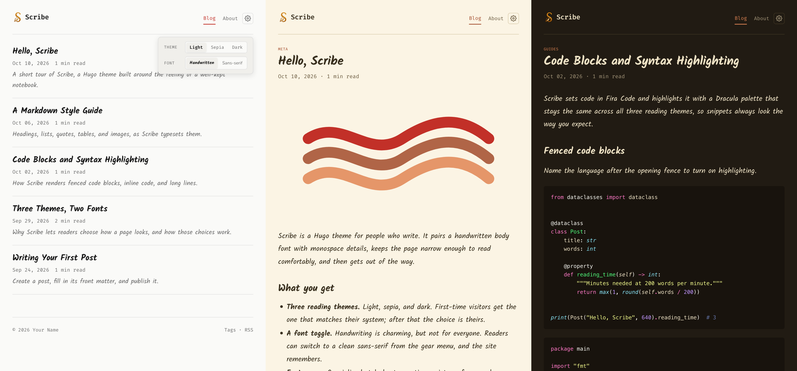

<h1 align="center">
  
</h1>

A minimal [Hugo](https://gohugo.io) theme for people who write. Handwritten
typography, three reading themes, and a font toggle that lets every reader
pick what is comfortable for them.



## Features

- **Light, sepia, and dark themes.** Follows the reader's system preference
  until they choose one from the gear menu.
- **Reader font toggle.** Switch between a handwritten face (Kalam) and a
  rounded sans-serif (Nunito).
- **No flash on load.** Preferences are stored in the browser and applied
  before the first paint.
- **Accessible by default.** Text colours meet WCAG AA contrast in every
  theme, controls are keyboard friendly, and motion respects
  `prefers-reduced-motion`.
- **Lightweight.** One inlined stylesheet and a small vanilla script. No
  framework, no build step beyond Hugo itself.
- **Social previews.** Open Graph and Twitter Card tags, with the image taken
  from front matter or the first image in the post.
- **Blog essentials.** Tags, categories, pagination, RSS, reading time,
  previous/next links, syntax highlighting, and a 404 page.
- **Testimonials shortcode.** Show quotes as a slider or a stacked list.
- **Easy to customise.** Override colours with a CSS file, add to `<head>`
  with a partial, and translate the interface with an i18n file.

## Requirements

Hugo **0.128.0** or newer. The standard edition is enough; the theme does not
use Sass.

## Installation

### As a Git submodule

From the root of your Hugo site:

```bash
git submodule add https://github.com/wasi0013/hugo-scribe.git themes/hugo-scribe
```

Then set the theme in `hugo.toml`:

```toml
theme = "hugo-scribe"
```

### As a Hugo module

```bash
hugo mod init github.com/<your-user>/<your-site>
```

```toml
[module]
  [[module.imports]]
    path = "github.com/wasi0013/hugo-scribe"
```

## Try the example site

```bash
git clone https://github.com/wasi0013/hugo-scribe.git
cd hugo-scribe
hugo server --source exampleSite --themesDir ../..
```

The example's [`hugo.toml`](exampleSite/hugo.toml) is a good starting point
for your own site.

## Configuration

```toml
baseURL = "https://example.org/"
title = "My Blog"
theme = "hugo-scribe"

[pagination]
  pagerSize = 10

[params]
  author = "Your Name"
  description = "A few words about this site."
  mainSections = ["posts"]
  dateFormat = "Jan 02, 2006"
  showReadingTime = true
  logo = "logo.png"
  favicon = "favicon.png"
  socialImage = "images/social.png"
  defaultTheme = "auto"
  defaultFont = "handwritten"

[markup.highlight]
  noClasses = false

[[menus.main]]
  name = "Blog"
  pageRef = "/"
  weight = 1

[[menus.main]]
  name = "About"
  pageRef = "/about"
  weight = 2

[[menus.footer]]
  name = "Tags"
  pageRef = "/tags"
  weight = 1
```

### Parameters

| Parameter         | Default          | Description                                                                                  |
| ----------------- | ---------------- | -------------------------------------------------------------------------------------------- |
| `author`          | site title       | Used in the footer copyright line and the `author` meta tag.                                 |
| `description`     | none             | Default meta description for pages that don't set their own.                                 |
| `mainSections`    | largest section  | Sections whose pages are treated as posts and listed on the home page.                       |
| `dateFormat`      | `"Jan 02, 2006"` | Date layout, in [Go's reference time](https://gohugo.io/functions/time/format/) notation.    |
| `showReadingTime` | `true`           | Show the estimated reading time next to the date.                                            |
| `logo`            | none             | Image shown next to the site title. Path relative to `static/`.                              |
| `favicon`         | `"favicon.png"`  | Browser tab icon. Path relative to `static/`.                                                |
| `socialImage`     | `logo`           | Fallback image for sharing previews. Use a PNG or JPEG of about 1200×630.                    |
| `defaultTheme`    | `"auto"`         | Theme for first-time visitors: `auto`, `light`, `sepia`, or `dark`.                          |
| `defaultFont`     | `"handwritten"`  | Font for first-time visitors: `handwritten` or `sans`.                                       |

Set the top-level `copyright` option to replace the footer's default
copyright line. Markdown is supported.

### Syntax highlighting

The theme includes a Dracula stylesheet for Hugo's built-in highlighter. Set
`markup.highlight.noClasses = false`, as shown above, so Hugo emits class
names instead of inline styles.

### Menus

The `main` menu is shown in the header and the `footer` menu in the footer.
An RSS link is added to the footer automatically. Keep the main menu short:
two or three entries fit on one line on a phone.

## Writing

### Posts

```bash
hugo new content posts/my-first-post.md
```

```toml
+++
title = 'My First Post'
date = '2026-09-24T09:00:00+00:00'
draft = false
description = 'Shown in post lists, search results, and sharing previews.'
tags = ['notes']
categories = ['Writing']
featured_image = 'images/cover.jpg'
+++
```

`description` falls back to the post's summary. `featured_image` is shown
above the post and used as its sharing image; without it, the first image in
the post is used for sharing previews.

### Pages

Content outside your main sections, such as `content/about.md`, is rendered
as a standalone page with no date, tags, or previous/next links.

### Home page

The home page lists your posts. Anything you write in `content/_index.md` is
shown above the list.

## Shortcodes

### Testimonials

```markdown



Clear communication from the first message to the final handover.



Every draft arrives clean and on time.



```

Cards are shown in a slider that advances every five seconds. Use
`` to stack them instead.

| Parameter | Description                                                           |
| --------- | --------------------------------------------------------------------- |
| `name`    | The person's name. Required.                                          |
| `role`    | Shown under the name in muted text.                                   |
| `badge`   | A highlighted label, shown under the name.                            |
| `avatar`  | Image path relative to `static/`. Defaults to the person's initial.   |

## Customisation

### Colours and styles

Create `assets/css/custom.css` in your site. It is appended to the theme's
stylesheet, so you can override any of its variables:

```css
:root {
  --accent: #2563eb;
  --accent-hover: #1d4ed8;
  --content-width: 720px;
}

:root[data-theme="dark"] {
  --accent: #7aa2f7;
}
```

Each theme defines the same set of variables. See the top of
[`assets/css/main.css`](assets/css/main.css) for the full list. If you
change the dark palette, repeat the override inside
`@media (prefers-color-scheme: dark)` for `:root:not([data-theme])` so it
also applies to visitors who are following their system setting.

### Fonts

Fonts are loaded from Google Fonts by
[`layouts/partials/fonts.html`](layouts/partials/fonts.html). To self-host
them or swap in different faces, copy that partial to your site's
`layouts/partials/` folder, edit it, and set `--font-body` and `--font-mono`
in `custom.css`.

### Extra `<head>` content

Create `layouts/partials/head-custom.html` in your site to add analytics,
verification tags, or anything else to `<head>`.

### Translations

Interface text lives in [`i18n/en.toml`](i18n/en.toml). To translate it, copy
the file to your site's `i18n/` folder and name it after your language, for
example `i18n/de.toml`.

## Contributing

Bug reports and pull requests are welcome. Please preview your change with
the example site before opening a pull request.

## License

Released under the [MIT License](LICENSE).

Kalam, Nunito, and Fira Code are served by Google Fonts under the SIL Open
Font License. The syntax highlighting palette is
[Dracula](https://draculatheme.com).
